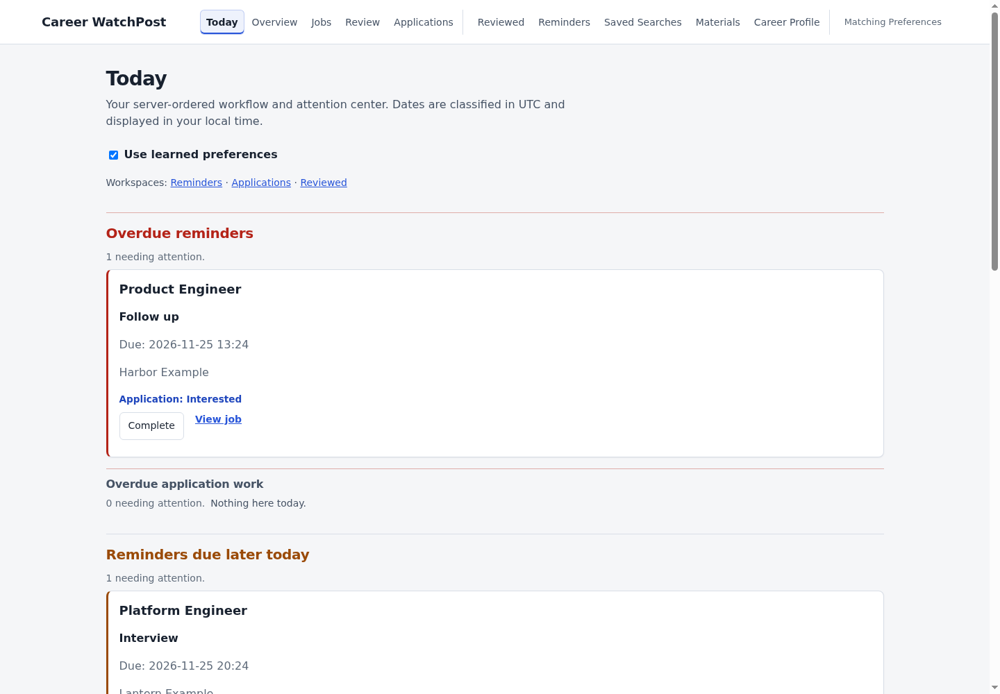
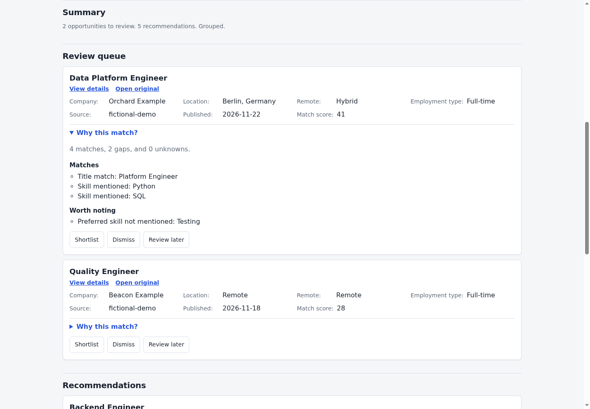
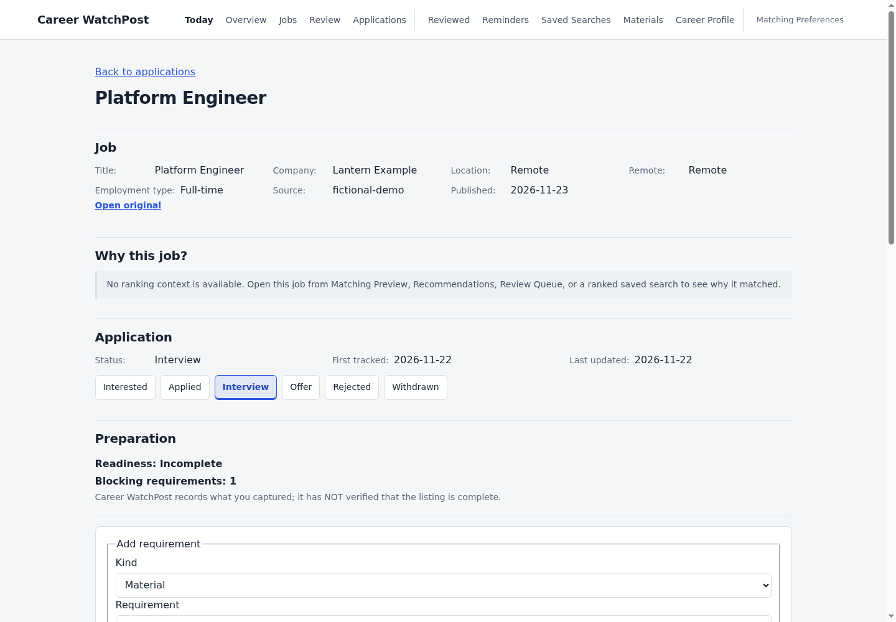
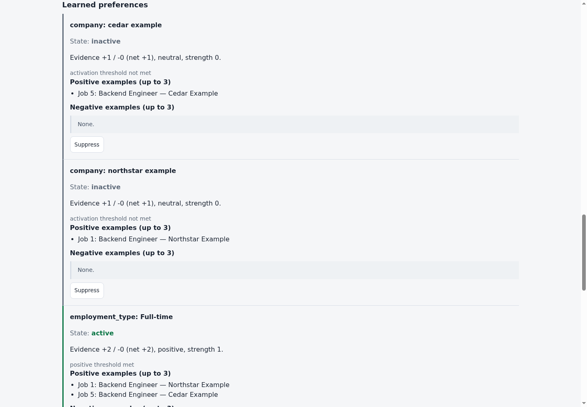
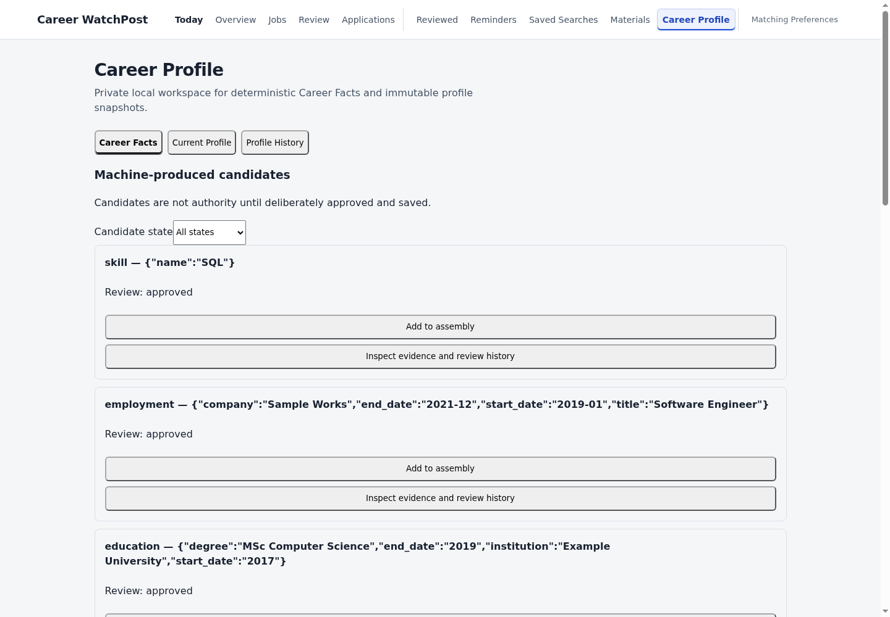

# Career WatchPost

Career WatchPost is a local-first career workflow for collecting public job
feeds, understanding fit with a deterministic candidate profile, and keeping
the human decisions that follow private. The public product name is Career
WatchPost; the stable Python distribution, import namespace, CLI, storage
paths, environment variables, API headers, and systemd units intentionally
remain `careeros` for compatibility.

Version `1.2.2` is qualified, owner accepted, and released as a source-only
repository on schema 14. It is a branding and portfolio release and does not
add product behavior, migrations, provider credentials, or hosted services.

This source-only repository preserves the genuine development sequence from
the original private project. Its public Git history is derived from that
history with privacy and presentation sanitization; commit chronology,
released functionality, and technical contracts are preserved. No wheel or
source-distribution release asset is published from this repository.

## What it does

- Collects jobs from seven built-in public sources with bounded, rate-aware
  polling; optional credential-free source configuration remains private.
- Searches, groups duplicate listings, ranks jobs with explainable deterministic
  scoring, and maintains a daily Review queue.
- Tracks applications, local reminders, saved searches, review decisions, and
  adaptive matching preferences in SQLite.
- Provides a local web workspace and CLI for Today, Workflow, Matching
  Preferences, Career Profile review, exports, and operational diagnostics.
- Keeps résumé extraction, sanitization, Career Facts, human review, and
  immutable Career Profiles local and deterministic. No LLM or external résumé
  service is called.

## Quick start

Requires Python 3.11 or newer and [uv](https://docs.astral.sh/uv/).

```bash
# Run from a source checkout (use tag v1.2.2 for the released application tree).
uv sync --extra development --extra api
uv run careeros diagnose
uv run careeros collect arbeitnow --limit 10 --database /tmp/careeros-demo.sqlite3
uv run careeros serve --database /tmp/careeros-demo.sqlite3
```

Then open `http://127.0.0.1:8000/ui`. Use a disposable database and fictional
profile/materials for demonstrations. The `collect arbeitnow` example accesses
a live public feed; omit it for a fictional portfolio walkthrough and use the
bounded demo guide below. Do not point examples at owner state.

## Portfolio tour

- [Fictional demonstration](docs/portfolio-demo.md) — a bounded, synthetic
  workflow using reserved example domains.
- [User and operations guide](docs/user-guide.md) — installation, private
  state, migrations, backups/recovery, sources, ranking, workflow, and
  troubleshooting reference.
- [Architecture diagram](docs/assets/career-watchpost-architecture.svg).
- [v1.2.2 qualification record](docs/v1.2.2-release-qualification.md) —
  inherited v1.2.1 authority versus new branding evidence.

## Product tour

All captures below come from the actual loopback application using a disposable
schema-14 database, a newly generated fictional résumé, and reserved
`example.com` URLs. No live provider or owner state was used.

| Workflow | Evidence |
|---|---|
| Today / Workflow and Attention Center | [](docs/assets/portfolio-screenshots/01-today-workflow.png) |
| Review queue and explainable scoring | [](docs/assets/portfolio-screenshots/02-review-scoring.png) |
| Applications, preparation, and reminders | [](docs/assets/portfolio-screenshots/03-applications-reminders.png) |
| Matching Preferences and deterministic learning | [](docs/assets/portfolio-screenshots/04-matching-preferences.png) |
| Career Fact review and provenance | [](docs/assets/portfolio-screenshots/05-career-profile-provenance.png) |

## Engineering highlights

Career WatchPost uses a modular Python/SQLite core, a FastAPI loopback
interface, deterministic ranking and grouping, explicit write locks, bounded
collector responses, immutable Career Profile provenance, and fail-closed
private-file handling. Read-only commands do not create persistent state.

The repository contains focused tests, strict type checking, formatting/lint
checks, and release qualification records. Historical CareerOS records are
retained as privacy-sanitized release summaries rather than rewritten as new
Career WatchPost achievements.

## Privacy and rights boundary

The application is local-first: private databases, Materials, candidate
profiles, exports, logs, and configuration belong outside the repository.
Publishing source code does not grant rights to redistribute collected job
descriptions, provider payloads, logos, or other third-party data. Demos and
screenshots use fictional data only. Career WatchPost never submits an
application, sends email, or contacts an employer.

Supported résumé inputs are text-based PDF and ordinary DOCX. OCR/image-only
PDF, legacy DOC, and arbitrary multiline/column PDF geometry reconstruction
remain unsupported; ambiguous extraction is omitted for human review.

## Compatibility note

Use the established commands such as `uv run careeros ...`, the `CAREEROS_*`
environment variables, and XDG `careeros` directories. This is deliberate:
Career WatchPost is a public identity transition, not a technical namespace
or storage migration.

## License

Source is released under the [MIT License](LICENSE). Review dependency and
provider-specific attribution requirements before redistributing collected
data or publishing a live-data demonstration.

Detailed installation, migration, backup, private-state, source-policy, and
command guidance is retained in the linked user guide rather than silently
removed.
