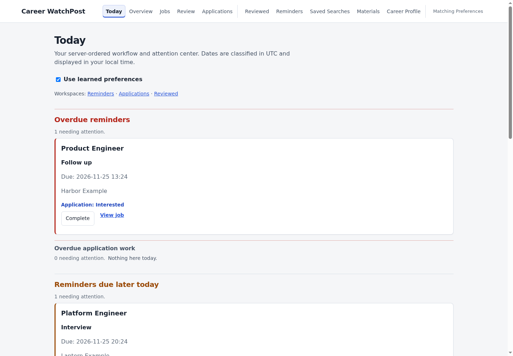
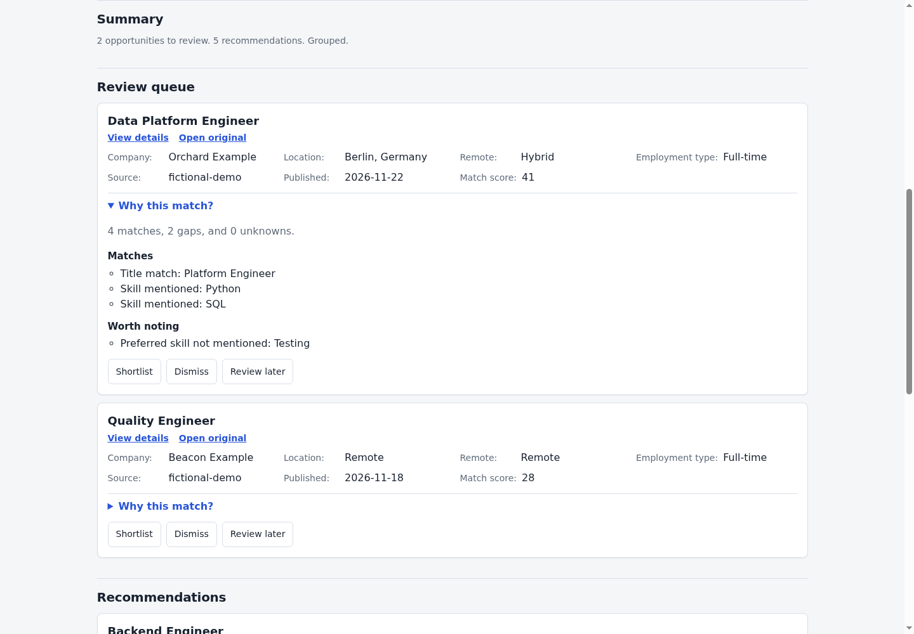
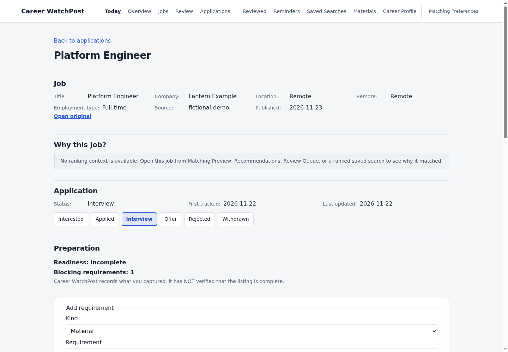
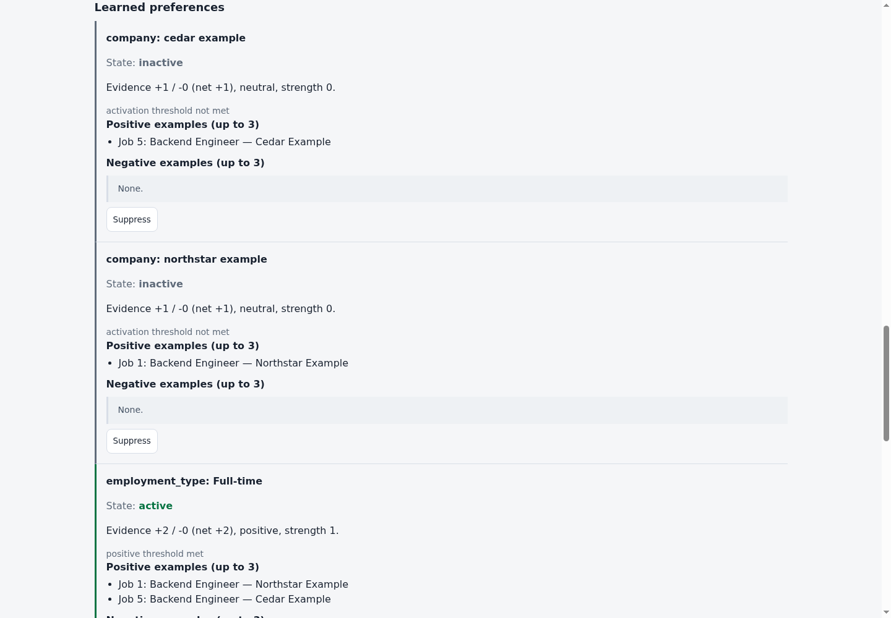
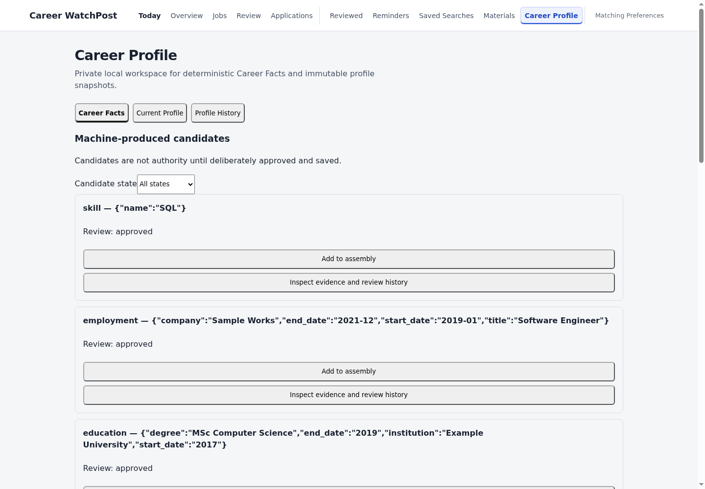

# Portfolio feature tour

This is a tour of committed screenshots captured from the actual loopback
application with fictional disposable data. It is not a reproducible fixture,
seed command, hosted demo, or promise that a fresh checkout recreates the
captures. Installation is documented separately in the [user guide](user-guide.md).

The captures use fictional jobs, reserved example URLs, a generated text-based
résumé, and disposable database, Materials, configuration, and browser paths.
They do not show live provider collection, credentials, application
submission, OCR, arbitrary PDF layout reconstruction, model-assisted
extraction, or owner data. Career WatchPost has no product interface for
inventing job listings; `collect` accesses live public providers.

## Today: daily priorities and workflow context

Today brings review priorities and workflow context into a bounded daily view.
See the [web workflow](user-guide.md#a-practical-web-workflow) for how to move
from this overview to a concrete job or reminder.

[Open full-size Today screenshot](assets/portfolio-screenshots/01-today-workflow.png).

## Review: explainable matching before a decision

Deterministic score components make the ranking inspectable before a human
review decision. See [search and Review](user-guide.md#discovery-search-and-review).

[Open full-size Review screenshot](assets/portfolio-screenshots/02-review-scoring.png).

## Applications and reminders: track the next step

Local application status and follow-up planning keep actions attached to
concrete jobs. See [applications and reminders](user-guide.md#applications-and-reminders).

[Open full-size Applications screenshot](assets/portfolio-screenshots/03-applications-reminders.png).

## Matching Preferences: explicit choices and learned evidence

Explicit preferences and learned-evidence controls let the user inspect and
adjust matching behavior. See the [adaptive recommendations contract](architecture/adaptive-recommendations.md).

[Open full-size Matching Preferences screenshot](assets/portfolio-screenshots/04-matching-preferences.png).

## Career Profile: reviewed facts with provenance

Reviewed Career Facts retain their evidence lineage. A deliberate save creates
an immutable profile version; see [saving a Career Profile](user-guide.md#saving-a-career-profile).

[Open full-size Career Profile screenshot](assets/portfolio-screenshots/05-career-profile-provenance.png).
